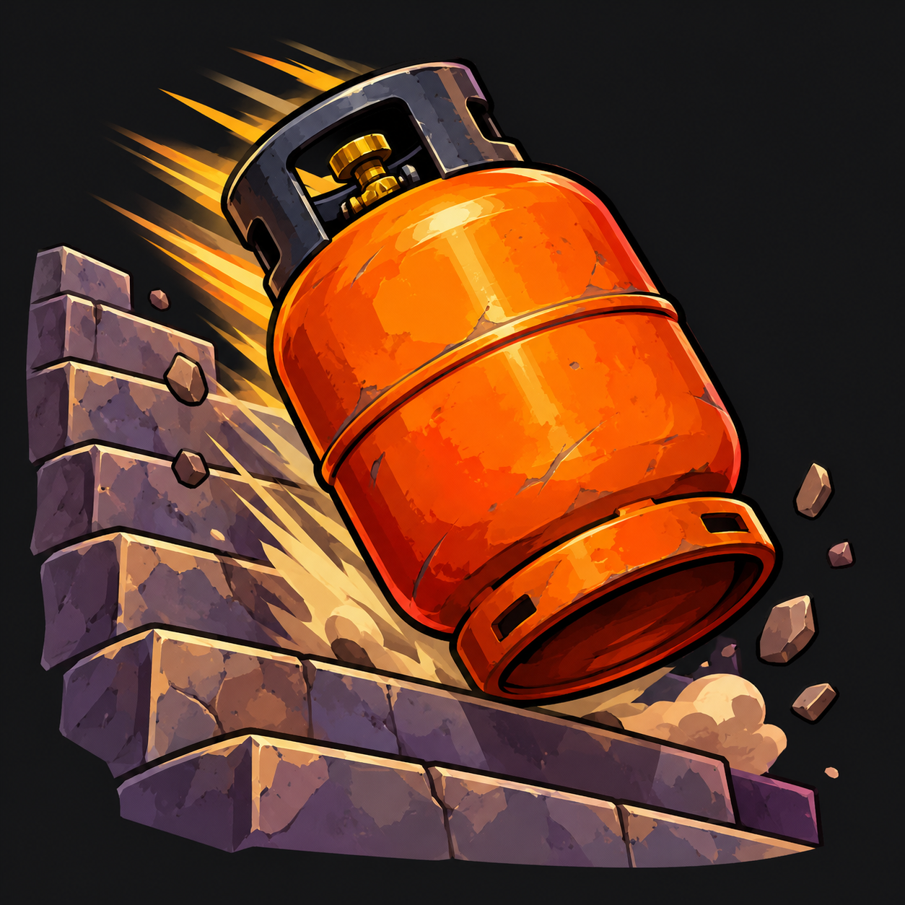

<p align="center">
  
</p>

# ButanoDeath - Addon para WoW

Este addon reproduce el temazo del año cuando mueres.

---

## 📁 Estructura del Addon

La carpeta del addon debe llamarse exactamente **`ButanoDeath`** y colocarse en:

```text
World of Warcraft/
└── Interface/
    └── AddOns/
        └── ButanoDeath/
            ├── ButanoDeath.toc
            ├── Core.lua
            └── sounds/
                └── death.mp3   <-- (Cambia este archivo si quieres sustituir el sonido original del addon, aunque no entiendo por qué querrías hacerlo)
```

## 🧪 Comandos de prueba

En el chat del juego puedes probar el audio escribiendo cualquiera de estos comandos:
- `/bd`
- `/butano`
- `/butanodeath`

