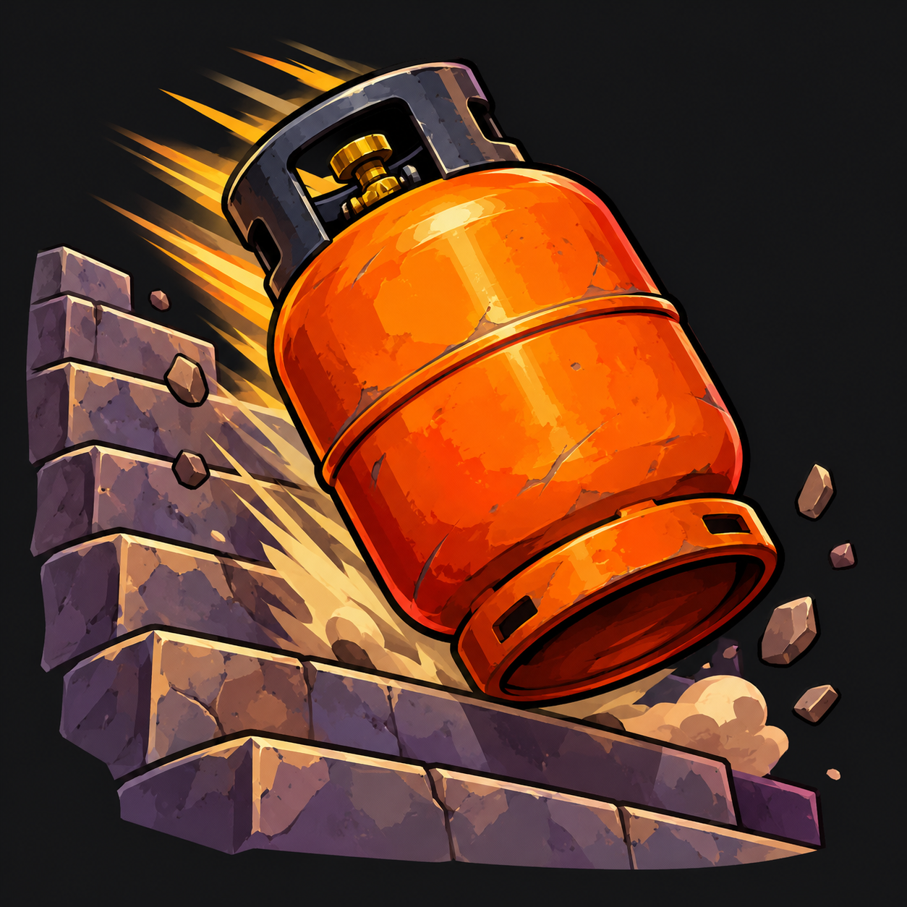

<p align="center">
  
</p>

# ButanoDeath - WoW Addon

This addon plays an absolute banger whenever you die.

---

## 📁 Addon Structure

The addon folder must be named exactly **`ButanoDeath`** and placed in:

```text
World of Warcraft/
└── Interface/
    └── AddOns/
        └── ButanoDeath/
            ├── ButanoDeath.toc
            ├── Core.lua
            └── sounds/
                └── death.mp3   <-- (Replace this file if you want to change the addon's original sound, though I can't imagine why you'd want to)
```

## 🧪 Test Commands

You can test the audio in-game by typing any of the following slash commands in chat:
- `/bd`
- `/butano`
- `/butanodeath`
